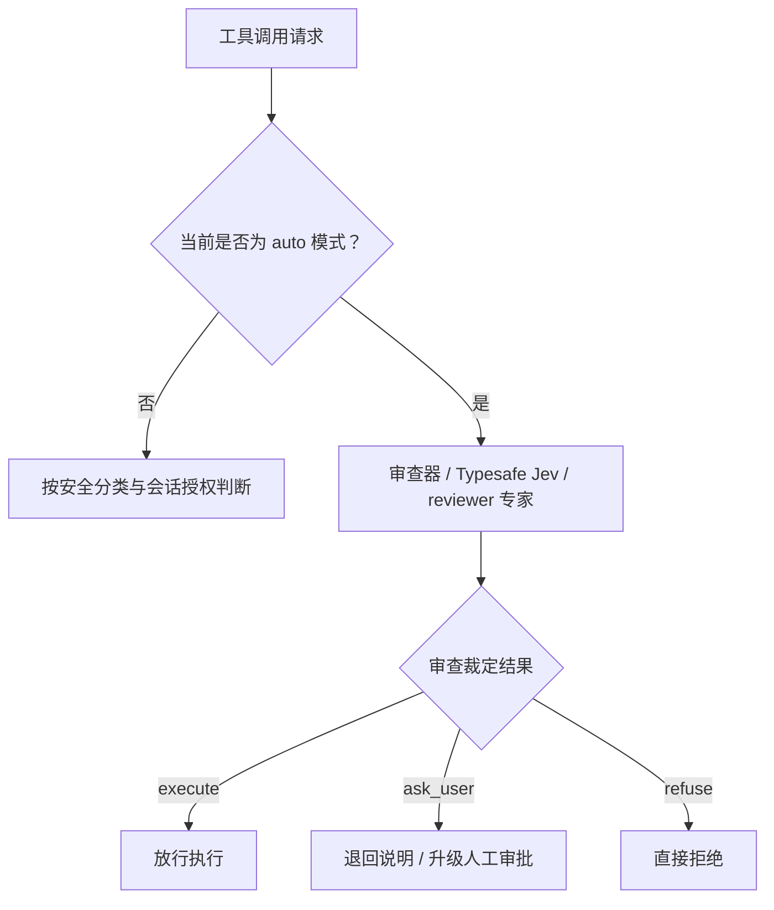

# 权限模型与安全审批

letcode 按工具类别、运行模式与会话授权决定审批策略。`auto` 模式使用审查专家或 Typesafe Jev 后端。

## 运行模式

在 `letcode.toml` 中配置权限模式，也可在 TUI 中用 `/permission`（或 `/perm`）切换。

```toml
[permissions]
mode = "default" # safe | default | auto | yolo
```

系统提供四种运行模式。

- `safe`（安全模式）。常规工具与外部工具调用均弹出人工审批。
- `default`（默认开发模式）。放行工作区内的安全读取和差异预览，文件修改、命令执行与网络请求弹出人工审批。
- `auto`（自动化审查模式）。沿用 `default` 的工具分类，待审批调用交由审查器判定。审查器支持放行、要求补充理由、转人工审批或拒绝。
- `yolo`（全自动模式）。直接放行工具调用，保持工具作用域与子代理路径限制。

## 工具安全分类

系统按工具声明的安全属性分类处理调用。

| 安全类别 | 代表工具 | 默认模式策略 |
| --- | --- | --- |
| `Read`（安全读取） | `fs__list`、`fs__read`、`search__rg`、`git__status`、`git__diff` 和 `git__log` | 放行 |
| `Preview`（只读预览） | `code__ast_replace_preview` | 放行 |
| `Write`（写入修改） | `fs__write`、`fs__append`、`fs__mkdir` 和 `edit__apply_patch` | 审批 |
| `Command`（命令执行） | `shell__exec` | 审批 |
| `Unknown`（未知分类） | 未声明安全属性的 MCP 工具与扩展 | 审批 |

系统内部工具（`question`、`workflow__todos` 和 `skill`）属于元操作，直接放行执行。

## 会话级授权

在 `default` 模式下，用户可通过审批弹窗指定处理策略。

1. `Deny`（拒绝）。取消本次工具执行，把拒绝原因返回给模型。
2. `AllowOnce`（允许一次）。放行本次特定参数调用。
3. `AllowAlways`（始终允许）。在当前会话内，对匹配相同参数特征的调用自动放行。

授权规则保存在内存的 `SessionGrants` 中。工作区路径改变、权限模式切换或会话重置时，保存的授权规则自动清空。

## 自动审查

在 `auto` 模式下，系统通过配置的审查器裁决风险。



系统支持两种审查后端。

- **Typesafe Jev**。在配置中声明 `reviewer = "jev"` 的专用模型路由。审查时向接口发送 choice 评估请求，由后端返回安全概率值，依据放行阈值判定。
- **内置 `reviewer` 专家**。使用独立的专家模型路由，输出 `execute`、`ask_user` 或 `refuse` 的结构化裁决。判定为 `ask_user` 时，系统先退回请求方补充理由；仍不明确时转人工审批。

审查服务异常或响应损坏时，系统直接拒绝。单次运行的 CLI 模式（如 `--print`）遇审批调用直接失败。

## 子代理权限继承与路径隔离

子代理继承父会话当前的权限模式，各会话的授权规则相互独立。

只读专家（`explorer` 和 `oracle`）提供只读与分析工具。`fixer` 与 `general` 须声明 `owned_paths` 获取独占写锁。结构化文件工具按规范化路径校验范围，在所有权路径内执行写入。

`shell__exec` 走独立的命令审批流程。任务完成后的范围审计以日志中的变更记录与文件清单为准。

## 源码索引

- `src/permission.rs` 包含权限模式枚举、工具安全类别分类、判定规则与会话授权存储。
- `src/session/runner.rs` 处理运行时工具拦截、异步审批等待与交互事件分发。
- `src/tool/command.rs` 与 `src/tool/fs.rs` 负责权限类别与路径边界核验。
- `src/subagent/pool.rs` 管理子代理独占路径锁与操作权限范围。
